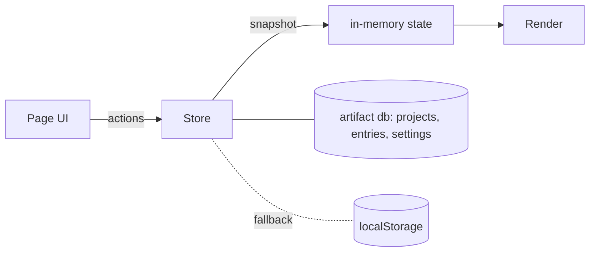

# ARCHITECTURE

## Overview
A single static page, `src/time-tracker.html`, published as an Artifact. There is no build step
and no libraries.

## Pattern
- **Store adapter** with two backends: `db` (realtime `onSnapshot`) and `local` (`localStorage`).
  Both expose `subscribe`, `put(col, id, data)` and `del(col, id)`. The UI never talks to a backend directly.
- **Render from state.** Any data change re-renders the whole page. A 1-second ticker updates
  only the elements marked `[data-tick]`, so typing is not interrupted.
- **A running timer lives in the data**: `project.runningSince` holds a start time in epoch ms. A timer
  therefore keeps running after a reload or on another device.
- **Stop writes immediately**: the entry is saved first with `note: ""`, then the prompt fills in
  the note. If the page closes mid-prompt, the time is kept and shown as "needs a label".

## Trust boundary
`db` rules: the owner alone reads and writes (`{path: "", read: "owner", write: "owner"}`).
Client names and notes therefore stay private if the link is shared.
